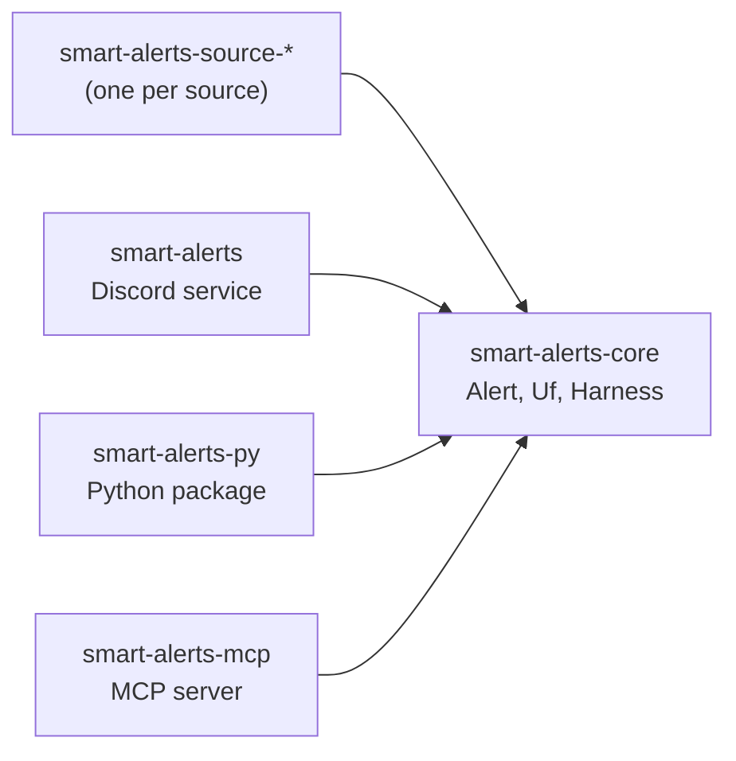

# smart-alerts

🇧🇷 [Leia em português](README.md)

22nd century alerts.

## in one minute

- **smart-alerts is a generic alert engine.** It collects alerts from official sources, filters
  the alerts, and delivers the alerts.
- **The first hazard is floods in Brazil.** v0 serves the South region: Paraná (PR),
  Santa Catarina (SC) and Rio Grande do Sul (RS).
- **v0 delivers a Discord service.** The Python package `smart-alerts` exists from the start.
  An AstrBot plugin will use this package in the future.
- **Status:** bootstrap. No source is implemented. The service only sends a test message.

## sources

Brazilian data is scattered. Each source is its own module: a new source does not change the
core.

Checked on 2026-10-22. Each endpoint was requested twice: from inside Brazil (`curl`) and from
outside Brazil (an HTTP client on a server abroad). No source blocks access by country. No source
publishes a rule about foreign access. The endpoint, the format and the authentication of each
source are in [`docs/SOURCES.md`](docs/SOURCES.md).

| Source | Official API | Format | Authentication | Outside Brazil | Version |
|---|---|---|---|---|---|
| Defesa Civil (IDAP) | yes, not documented ⚠ | Atom with CAP 1.2 | none | reachable | v0 |
| INMET | yes | RSS and CAP 1.2; undocumented JSON | none (warnings); token by email (stations) | reachable | v0 |
| CEMADEN | yes (observations) | REST JSON | free registration (JWT) | reachable | v0 |
| ANA | yes | REST JSON; legacy SOAP | registration with CPF/CNPJ (REST); none (SOAP) | reachable; registration can require a CPF/CNPJ ⚠ | planned |
| CPTEC/INPE | yes, forecasts only | XML | none | reachable; non-commercial use | planned |
| Epagri/Ciram (SC) | partial | WordPress RSS and JSON, free text | none (warnings); CPF (station data) | reachable | planned |
| SGB (SACE) | no | HTML; PDF bulletins | none | reachable | planned |
| Defesa Civil RS | no | PDF; undocumented ClimaRS JSON | none | reachable | planned |
| SIMEPAR (PR) | none found | — | — | blocked from every country (Cloudflare) | planned |

**What each source requires from the code:**

- **Defesa Civil (IDAP):** the feed `idapfile.mdr.gov.br/idap/api/rss/cap` keeps about 12 hours
  of alerts ⚠ and is about 10 MB. The module must poll the feed often and store the alerts. The
  alerts of PR, SC and RS appear in this feed. The SC Civil Defense also publishes a free-text RSS.
- **INMET:** `apiprevmet3.inmet.gov.br` drops the connection when the User-Agent is curl's
  default (`curl/...`). smart-alerts identifies itself by its own name (`smart-alerts/<version>`),
  and INMET accepts this name. The RSS declares public domain, with citation of the source.
- **CEMADEN:** the PED API (`sws.cemaden.gov.br/PED`) gives observations, not alerts. The
  municipal alerts exist only in an undocumented JSON (`painelalertas.cemaden.gov.br/wsAlertas2`).
  The limit is 12 requests per minute for an external user ⚠. CEMADEN requires citation.
- **ANA:** the REST token is valid for 60 minutes. Frequent token requests can block the IP.
- **CPTEC/INPE:** the terms forbid commercial use without authorization and require the citation
  "CPTEC/INPE". The service has no warnings.
- **Defesa Civil RS:** it replaced the SEMA-RS Sala de Situação in February 2025. The ClimaRS JSON
  (ANA river levels) can change without notice.
- **SIMEPAR:** no automatic client passes the Cloudflare challenge. The source gets no module
  until SIMEPAR publishes an API.

## local models

Some sources publish free text (bulletins, PDFs). For these sources, smart-alerts will use open
models that run on the local machine. A paid API is never required.

| Runtime | License | Use in smart-alerts | Status |
|---|---|---|---|
| [Ollama](https://github.com/ollama/ollama) | MIT | Read free text and extract fields (place, time, river level) into an `Alert`. | planned |
| [OLLAYA](https://github.com/ollaya-dev/ollaya) | Apache-2.0 | Decide: typed questions (is this a flood alert? which severity?) with a calibrated probability. It does not generate text. | soon |

A model never invents an alert. When the model is not sure, the alert goes back to the
deterministic harness and is marked for human review.

## architecture



<details open>
<summary>How to read this figure</summary>

**In one sentence.** Every crate depends on `smart-alerts-core`. The core depends on no crate.

**How to read.** Each arrow goes from the crate that uses to the crate that is used.

**Not shown.** The source crates do not exist yet. The harness composes pure stages
(`Fn(Alert) -> Option<Alert>`): see `AGENTS.md`.

**Evidence.** The `Cargo.toml` of each crate in `crates/`.

</details>

## use

```console
nix develop
just check                                  # formatting, clippy, tests, licenses
DISCORD_WEBHOOK_URL=... just test-message   # send a test message to Discord
just mcp                                    # MCP server on stdio
just py-build                               # build the Python package
```

## documentation

The documentation exists in four languages: pt-BR, English, Chinese and Japanese. The pages are
in `wiki/`. The GitHub Wiki gets the pages only after the repository is public (issue #1).

## credits

- The functional harness translates the
  [Object-Oriented Harness](https://arxiv.org/abs/2610.28380) (arXiv 2610.28380) into function
  composition.
- The pt-BR writing follows [ptbr-writer](https://github.com/h0ffmann/ptbr-writer).
- The English writing follows the model of ASD-STE100.
- The Japanese follows やさしい日本語 (Easy Japanese).

## how to cite

Use [`CITATION.cff`](CITATION.cff), with the commit or the tag you used. [`REUSE.toml`](REUSE.toml)
gives the license and the copyright of each file, and the citation rules for agents.

## license

[MPL-2.0](LICENSE).
