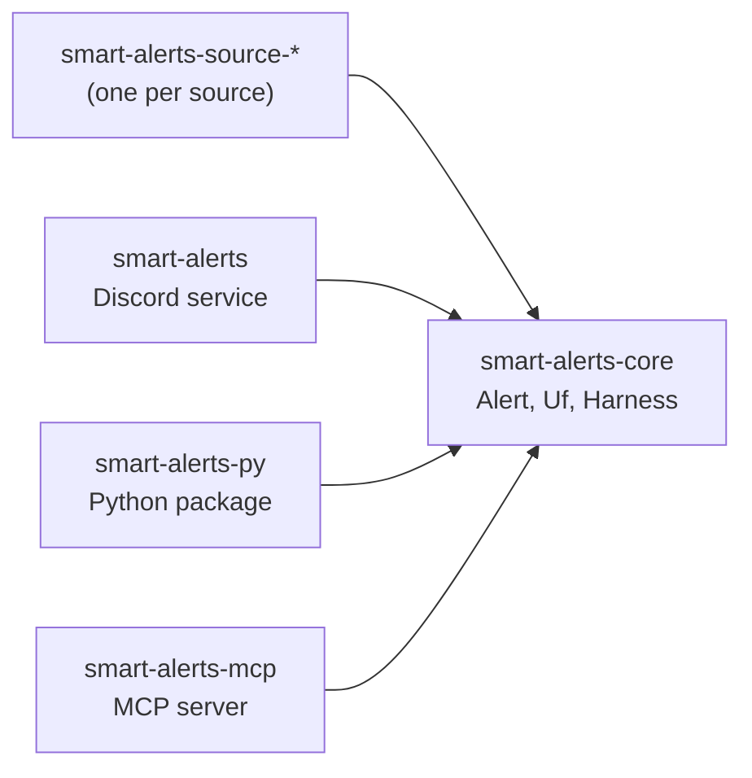

# smart-alerts

🇧🇷 [Leia em português](README.md)

22nd century alerts.

## in one minute

- **smart-alerts is a generic alert engine.** It collects alerts from official sources, filters
  the alerts, and delivers the alerts.
- **The first hazard is floods in Brazil.** v0 serves the South region: Paraná (PR),
  Santa Catarina (SC) and Rio Grande do Sul (RS).
- **v0 delivers a Discord service.** The Python package `smart-alerts` exists from the start.
  An AstrBot plugin will use this package in the future.
- **Status:** bootstrap. No source is implemented. The service only sends a test message.

## sources

Brazilian data is scattered. Each source is its own module: a new source does not change the
core. Nobody has verified the access method of each source yet ⚠.

| Source | Agency | Coverage | Version |
|---|---|---|---|
| Defesa Civil | National and state Civil Defense | Brazil | v0 |
| INMET | National Institute of Meteorology | Brazil | v0 |
| CEMADEN | National Center for Monitoring and Early Warning of Natural Disasters | Brazil | v0 |
| SGB | Geological Survey of Brazil (hydrological alert systems) | monitored basins | planned |
| ANA | National Water and Sanitation Agency (hydrological telemetry) | Brazil | planned |
| SIMEPAR | Paraná Environmental Technology and Monitoring System | PR | planned |
| Epagri/Ciram | SC Center for Environmental Resources and Hydrometeorology | SC | planned |
| Sala de Situação RS | RS Department of Environment and Infrastructure | RS | planned |
| CPTEC/INPE | Center for Weather Forecasting and Climate Studies | Brazil | planned |

## architecture



<details open>
<summary>How to read this figure</summary>

**In one sentence.** Every crate depends on `smart-alerts-core`. The core depends on no crate.

**How to read.** Each arrow goes from the crate that uses to the crate that is used.

**Not shown.** The source crates do not exist yet. The harness composes pure stages
(`Fn(Alert) -> Option<Alert>`): see `AGENTS.md`.

**Evidence.** The `Cargo.toml` of each crate in `crates/`.

</details>

## use

```console
nix develop
just check                                  # formatting, clippy, tests, licenses
DISCORD_WEBHOOK_URL=... just test-message   # send a test message to Discord
just mcp                                    # MCP server on stdio
just py-build                               # build the Python package
```

## documentation

The documentation exists in four languages: pt-BR, English, Chinese and Japanese. The pages are
in `wiki/`. The GitHub Wiki gets the pages only after the repository is public (issue #1).

## credits

- The functional harness translates the
  [Object-Oriented Harness](https://arxiv.org/abs/2610.28380) (arXiv 2610.28380) into function
  composition.
- The pt-BR writing follows [ptbr-writer](https://github.com/h0ffmann/ptbr-writer).
- The English writing follows the model of ASD-STE100.
- The Japanese follows やさしい日本語 (Easy Japanese).

## how to cite

Use [`CITATION.cff`](CITATION.cff), with the commit or the tag you used. [`REUSE.toml`](REUSE.toml)
gives the license and the copyright of each file, and the citation rules for agents.

## license

[MPL-2.0](LICENSE).
