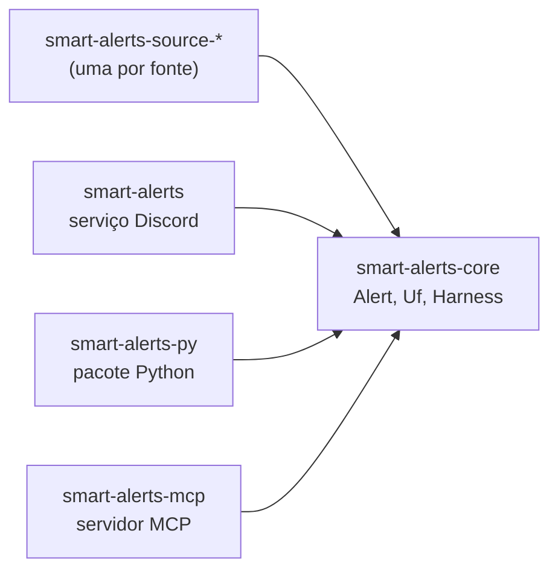

# smart-alerts

🇬🇧 [Read in English](README.en.md)

Alertas do século 22.

## em um minuto

- **O smart-alerts é um motor de alertas genérico.** Ele coleta alertas de fontes oficiais,
  filtra os alertas e entrega os alertas.
- **O primeiro risco é inundação no Brasil.** A v0 atende a Região Sul: Paraná (PR),
  Santa Catarina (SC) e Rio Grande do Sul (RS).
- **A v0 entrega um serviço para Discord.** O pacote Python `smart-alerts` existe desde o
  início. Um plugin AstrBot vai usar esse pacote no futuro.
- **Estado:** bootstrap. Nenhuma fonte está implementada. O serviço só envia uma mensagem de teste.

## fontes

Os dados do Brasil estão espalhados. Cada fonte é um módulo próprio: adicionar uma fonte não
muda o núcleo. O acesso de cada fonte ainda não foi verificado ⚠.

| Fonte | Órgão | Abrangência | Versão |
|---|---|---|---|
| Defesa Civil | Defesa Civil Nacional e estaduais | Brasil | v0 |
| INMET | Instituto Nacional de Meteorologia | Brasil | v0 |
| CEMADEN | Centro Nacional de Monitoramento e Alertas de Desastres Naturais | Brasil | v0 |
| SGB | Serviço Geológico do Brasil (sistemas de alerta hidrológico) | bacias monitoradas | planejada |
| ANA | Agência Nacional de Águas e Saneamento Básico (telemetria hidrológica) | Brasil | planejada |
| SIMEPAR | Sistema de Tecnologia e Monitoramento Ambiental do Paraná | PR | planejada |
| Epagri/Ciram | Centro de Informações de Recursos Ambientais e de Hidrometeorologia de SC | SC | planejada |
| Sala de Situação RS | Secretaria do Meio Ambiente e Infraestrutura do RS | RS | planejada |
| CPTEC/INPE | Centro de Previsão de Tempo e Estudos Climáticos | Brasil | planejada |

## arquitetura



<details open>
<summary>Como ler esta figura</summary>

**Em uma frase.** Todo crate depende do `smart-alerts-core`. O núcleo não depende de nenhum crate.

**Como ler.** Cada seta vai do crate que usa para o crate usado.

**Fora da figura.** As crates de fonte ainda não existem. O harness compõe estágios puros
(`Fn(Alert) -> Option<Alert>`): veja `AGENTS.md`.

**Evidência.** `Cargo.toml` de cada crate em `crates/`.

</details>

## usar

```console
nix develop
just check                                  # formatação, clippy, testes, licenças
DISCORD_WEBHOOK_URL=... just test-message   # envia uma mensagem de teste ao Discord
just mcp                                    # servidor MCP em stdio
just py-build                               # gera o pacote Python
```

## documentação

A documentação existe em quatro idiomas: pt-BR, inglês, chinês e japonês. As páginas estão em
`wiki/`. A Wiki do GitHub só recebe as páginas depois que o repositório for público (issue #1).

## créditos

- O harness funcional traduz o
  [Object-Oriented Harness](https://arxiv.org/abs/2610.28380) (arXiv 2610.28380) para composição
  de funções.
- A escrita em pt-BR segue o [ptbr-writer](https://github.com/h0ffmann/ptbr-writer).
- A escrita em inglês segue o modelo do ASD-STE100.
- O japonês segue a やさしい日本語 (japonês fácil).

## licença

[MPL-2.0](LICENSE).
