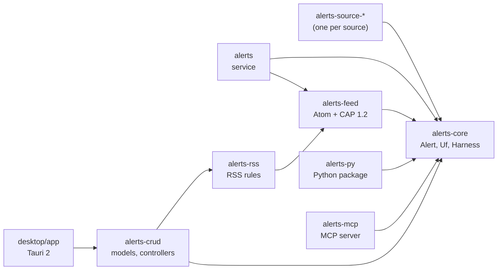
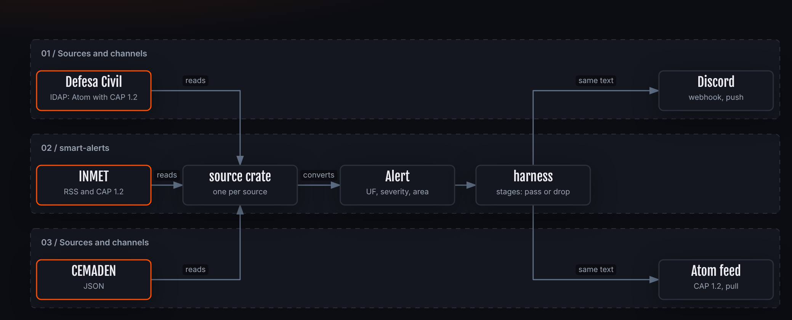
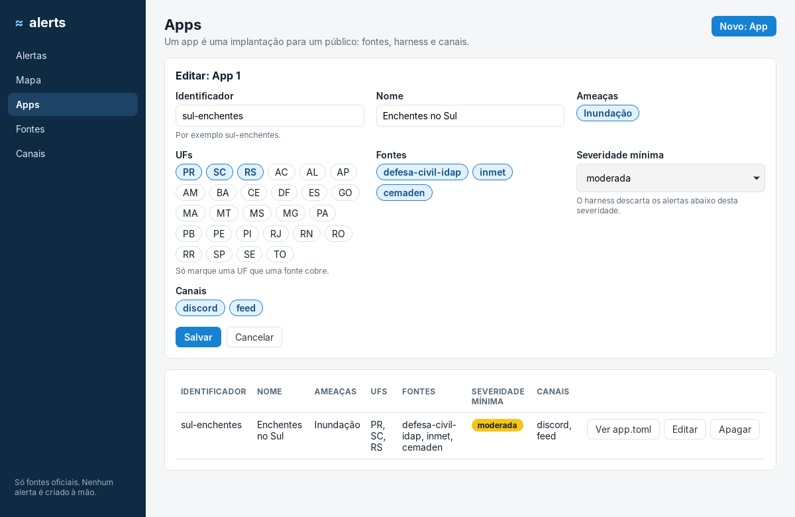

<!-- reading-time: 15 min -->
<div align="center">

<table>
<tr>
<td align="center"></td>
<td align="center"><a href="https://www.desmos.com/calculator/z7zooq9zsh"></a></td>
</tr>
<tr>
<td align="center"><sub><i>Fibonacci wave</i>, Matheus Hoffmann (<a href="https://github.com/h0ffmann">@h0ffmann</a>), 2026</sub></td>
<td align="center"><sub><a href="https://www.desmos.com/calculator/z7zooq9zsh"><i>Ammonite</i></a>, Harry Chen (<a href="https://github.com/harry7557558">@harry7557558</a>), 1st place, 2021 Desmos Global Math Art Contest</sub></td>
</tr>
<tr>
<td align="center"><sub>Desmos source: <a href="docs/drawings/wave.desmos.json"><code>wave.desmos.json</code></a></sub></td>
<td align="center"><sub>Desmos source: <a href="https://www.desmos.com/calculator/z7zooq9zsh"><code>desmos.com/calculator/z7zooq9zsh</code></a></sub></td>
</tr>
</table>

# alerts

<sub>22nd century alerts · <a href="#in-one-minute">in one minute</a> · <a href="#sources">sources</a> · <a href="#channels">channels</a> · <a href="#who-will-use-alerts">who uses it</a> · <a href="#architecture">architecture</a> · <a href="#how-to-cite">cite</a> · <a href="README.pt-BR.md">português</a></sub>

[](#in-one-minute)
[](#in-one-minute)
[](#sources)
[](#channels)
[](#architecture)
[](#license)

</div>

## In one minute

- **alerts is a generic alert platform.** It collects alerts from official sources, filters
  the alerts, and delivers the alerts. A hazard, a region or a channel is a module: the core does
  not change when a module is added.
- **Only official sources.** An alert comes from an authoritative agency. alerts never invents an
  alert, an area, a time or an action that the source does not state.
- **The first hazard is floods in Brazil.** v0 serves the South region: Paraná (PR),
  Santa Catarina (SC) and Rio Grande do Sul (RS).
- **v0 delivers a Discord service** and an Atom feed with CAP 1.2 alerts, with the same alerts
  and the same text. The Python package `piabrota-alerts` exists from the start, for an
  [AstrBot](#who-will-use-alerts) plugin.
- **Open by design.** Open standards (Atom, CAP 1.2), FOSS dependencies only, local models only.
  A paid API is never required.
- **Status:** bootstrap. No agency source is implemented. The service sends a test message, and
  `alerts poll mock` sends simulated test alerts through the harness to Discord and the feed.

## Sources

Brazilian data is scattered. Each source is its own module: a new source does not change the
core.

Checked on 2026-10-22. Each endpoint was requested twice: from inside Brazil (`curl`) and from
outside Brazil (an HTTP client on a server abroad). No source blocks access by country. No source
publishes a rule about foreign access. The endpoint, the format and the authentication of each
source are in [`docs/SOURCES.md`](docs/SOURCES.md).

| Source | Official API | Format | Authentication | Outside Brazil | Version |
|---|---|---|---|---|---|
| Defesa Civil (IDAP) | yes, not documented ⚠ | Atom with CAP 1.2 | none | reachable | v0 |
| INMET | yes | RSS and CAP 1.2; undocumented JSON | none (warnings); token by email (stations) | reachable | v0 |
| CEMADEN | yes (observations) | REST JSON | free registration (JWT) | reachable | v0 |
| ANA | yes | REST JSON; legacy SOAP | registration with CPF/CNPJ (REST); none (SOAP) | reachable; registration can require a CPF/CNPJ ⚠ | planned |
| CPTEC/INPE | yes, forecasts only | XML | none | reachable; non-commercial use | planned |
| Epagri/Ciram (SC) | partial | WordPress RSS and JSON, free text | none (warnings); CPF (station data) | reachable | planned |
| SGB (SACE) | no | HTML; PDF bulletins | none | reachable | planned |
| Defesa Civil RS | no | PDF; undocumented ClimaRS JSON | none | reachable | planned |
| SIMEPAR (PR) | none found | — | — | blocked from every country (Cloudflare) | planned |

**What each source requires from the code:**

- **Defesa Civil (IDAP):** the feed `idapfile.mdr.gov.br/idap/api/rss/cap` keeps about 12 hours
  of alerts ⚠ and is about 10 MB. The module must poll the feed often and store the alerts. The
  alerts of PR, SC and RS appear in this feed. The SC Civil Defense also publishes a free-text RSS.
- **INMET:** `apiprevmet3.inmet.gov.br` drops the connection when the User-Agent is curl's
  default (`curl/...`). alerts identifies itself by its own name (`piabrota-alerts/<version>`).
  INMET accepted this User-Agent with the former project name on 2026-10-22. Nobody checked the
  new name ⚠. The RSS declares public domain, with citation of the source.
- **CEMADEN:** the PED API (`sws.cemaden.gov.br/PED`) gives observations, not alerts. The
  municipal alerts exist only in an undocumented JSON (`painelalertas.cemaden.gov.br/wsAlertas2`).
  The limit is 12 requests per minute for an external user ⚠. CEMADEN requires citation.
- **ANA:** the REST token is valid for 60 minutes. Frequent token requests can block the IP.
- **CPTEC/INPE:** the terms forbid commercial use without authorization and require the citation
  "CPTEC/INPE". The service has no warnings.
- **Defesa Civil RS:** it replaced the SEMA-RS Sala de Situação in February 2025. The ClimaRS JSON
  (ANA river levels) can change without notice.
- **SIMEPAR:** no automatic client passes the Cloudflare challenge. The source gets no module
  until SIMEPAR publishes an API.

## Local models

Some sources publish free text (bulletins, PDFs). For these sources, alerts will use open
models that run on the local machine. A paid API is never required.

| Runtime | License | Use in alerts | Status |
|---|---|---|---|
| [Ollama](https://github.com/ollama/ollama) | MIT | Read free text and extract fields (place, time, river level) into an `Alert`. | planned |
| [OLLAYA](https://github.com/ollaya-dev/ollaya) | Apache-2.0 | Decide: typed questions (is this a flood alert? which severity?) with a calibrated probability. It does not generate text. | soon |

A model never invents an alert. When the model is not sure, the alert goes back to the
deterministic harness and is marked for human review.

## Channels

| Channel | Standard | Delivery |
|---|---|---|
| Discord | Discord webhook | push |
| Feed | Atom (RFC 4287) with CAP 1.2 (OASIS) in each entry | pull |

Both channels read the same harness output: an alert that reaches Discord also reaches the feed,
with the same text. The feed depends on no company: Atom and CAP are open standards. The feed has
the same shape as the national Civil Defense feed (IDAP), and any feed reader opens the file. A
test alert has `<status>Test</status>`.

## Who will use alerts

| Consumer | What it is | How it reads alerts | Status |
|---|---|---|---|
| [Discord](https://discord.com/developers/docs/resources/webhook) | The v0 server, which already exists | webhook (push) | v0 |
| Any feed reader | Atom (RFC 4287) with CAP 1.2 in each entry | the feed file (pull) | v0 |
| [Obsidian](https://obsidian.md) | The plugin WeatherDisaster: one note per alert, for a second brain | the feed (pull) | new |
| [AstrBot](https://github.com/AstrBotDevs/AstrBot) | An open-source chatbot platform for messaging apps (AGPL-3.0) | the Python package `piabrota-alerts` in a plugin | planned |
| [astrbot_plugin_disaster_warning](https://github.com/Pancakes-Labs/astrbot_plugin_disaster_warning) | A disaster warning plugin for AstrBot: earthquakes, tsunamis, weather (AGPL-3.0) | the Python package or the feed, for alerts from Brazil | planned |

A plugin calls the package: alerts copies no AGPL code. More in
[`docs/REFERENCES.md`](docs/REFERENCES.md) (pt-BR).

## Architecture



<details open>
<summary>How to read this figure</summary>

**In one sentence.** Every crate depends on `alerts-core`. The core depends on no crate.

**How to read.** Each arrow goes from the crate that uses to the crate that is used.

**Not shown.** The source crates do not exist yet. The `alerts-scaffold` generator writes code into `alerts-crud` and depends on no crate. The harness composes pure stages
(`Fn(Alert) -> Option<Alert>`): see `GROUND_TRUTH.md`.

**Evidence.** The `Cargo.toml` of each crate in `crates/` and `desktop/`.

</details>

### The path of an alert



<details open>
<summary>How to read this figure</summary>

**Takeaway.** An official alert goes through one path, and Discord and the feed get the same text.

**How to read.** Left to right. An orange box is an official source. Each arrow is labelled with
what happens.

**Not shown.** The planned sources, the local models and the alerts that the harness drops.

**Evidence.** The Sources, Channels and Architecture sections of this README. No source crate
exists yet. The source: [`docs/archify/en/fluxo-alerta.json`](docs/archify/en/fluxo-alerta.json).

</details>

## Use

```console
nix develop
just check                                  # formatting, clippy, tests, licenses
DISCORD_WEBHOOK_URL=... just test-message   # send a test message to Discord
FEED_PATH=alerts.atom just test-message     # write the Atom + CAP 1.2 feed with a test alert
MAROLA_DISCORD_WEBHOOK_URL=... just marola-discord   # a test alert to the official Marola Discord
just obsidian                               # build the Obsidian plugin WeatherDisaster
just mcp                                    # MCP server on stdio
just py-build                               # build the Python package
just reading-time                           # write the reading time of every file for humans
just figure                                 # draw docs/archify/*.json with Archify
just graph                                  # the code graph: build/graph/graph.html
just site                                   # the static site for piabrota.art/alerts/
just desktop-dev                            # the desktop app (Tauri 2), with live reload
just generate scaffold rivers slug:slug name:string   # a new CRUD resource in alerts-crud
```

## Desktop app

The desktop app configures apps in a window: the sources, the channels and the apps. It follows the
CRUD conventions of Loco: each resource has a model, a controller and a migration. The app also lists
the alerts that the sources delivered, next to a map. The app never creates an alert.

- `crates/alerts-crud`: the models, the controllers and the migrations, on SQLite. Every operation
  goes through `controllers::dispatch`.
- `crates/alerts-rss`: the RSS combinator. Each user has areas, projects and tasks, and each of
  them owns RSS feeds and rules that compose the feeds. See [`docs/RSS.md`](docs/RSS.md).
- `desktop/app`: Tauri 2. Its two commands (`modules`, `crud`) call `alerts-crud`.
- `desktop/ui`: the interface, in Rust (Leptos, compiled to wasm32). It draws each page from the
  spec of a resource, so a resource from `just generate scaffold` gets its page with no interface code.
- The map uses MapLibre GL JS 5.24.0 and OpenFreeMap tiles: no key and no account.



More in [`docs/DESKTOP.md`](docs/DESKTOP.md). The way to the App Store and Google Play, as
"marola alertas", is mapped in [`docs/STORES.md`](docs/STORES.md).

## Obsidian plugin

WeatherDisaster (id `piabrota-alerts`) feeds official alerts into an Obsidian vault. It reads an
Atom or RSS feed of CAP 1.2 alerts and writes one note per alert, with the CAP fields in the
frontmatter and the issuer's text verbatim. A CAP `Update` rewrites the note, and a CAP `Cancel`
marks it as cancelled. Filters: UF, IBGE municipality and lowest severity. A failed read shows as a
failure, never as "no alert". The logic is Rust (`crates/alerts-obsidian`), built to WebAssembly.

More in [`docs/OBSIDIAN.md`](docs/OBSIDIAN.md).

## Documentation

The documentation exists in four languages: pt-BR, English, Chinese and Japanese. The pages are
in `wiki/`. The GitHub Wiki gets the pages only after the repository is public (issue #1). Ideas
to host the site at `piabrota.art/alerts` are in [`docs/HOSPEDAGEM.md`](docs/HOSPEDAGEM.md) (pt-BR).

## Credits

- The reading-time calculator, the figure workflow and the site toolchain come from
  [ptbr-writer](https://github.com/h0ffmann/ptbr-writer) and picasso's labs (ptbr-tools,
  code-graph, gleam-website). Figures are drawn with [Archify](https://github.com/tt-a1i/archify),
  by @tt-a1i (MIT). The code graph uses the schema of [graphify](https://github.com/Graphify-Labs/graphify).
- The layout of this README comes from [picasso](https://github.com/h0ffmann/picasso).
- The drawing is by Matheus Hoffmann ([@h0ffmann](https://github.com/h0ffmann)). It is rendered from its
  Desmos expressions. The wave joins the Fibonacci spiral and Katsushika Hokusai's *The Great Wave off Kanagawa*
  (c. 1831). Other artists drew Fibonacci waves before: credits in [`docs/drawings/README.md`](docs/drawings/README.md).
- The app conventions (generators, doctor, scheduler, tasks) follow [Loco](https://loco.rs)
  (Apache-2.0). Screenshots of its bootstrap are in [`docs/screenshots/loco-bootstrap/`](docs/screenshots/loco-bootstrap).
  The CRUD layout of `alerts-crud` (models, controllers, migrations, scaffold) also follows Loco.
- The desktop map uses [MapLibre GL JS](https://maplibre.org) (BSD-3-Clause), [OpenFreeMap](https://openfreemap.org) tiles
  and OpenStreetMap data (ODbL). The desktop app uses [Tauri](https://tauri.app) (Apache-2.0 or MIT) and
  [Leptos](https://leptos.dev) (MIT).

- The functional harness translates the
  [Object-Oriented Harness](https://arxiv.org/abs/2610.28380) (arXiv 2610.28380) into function
  composition.
- The pt-BR writing follows [ptbr-writer](https://github.com/h0ffmann/ptbr-writer). The `open-pr` verb is its
  [`bipr`](https://github.com/h0ffmann/ptbr-writer/blob/main/skills/bipr/SKILL.md) skill, adapted (MPL-2.0).
- The English writing follows the model of ASD-STE100.
- The Japanese follows Easy Japanese (Yasashii Nihongo).

## How to cite

Use [`CITATION.cff`](CITATION.cff), with the commit or the tag you used. [`REUSE.toml`](REUSE.toml)
gives the license and the copyright of each file, and the citation rules for agents.

## License

| What | Terms |
|---|---|
| The code and the documentation | [MPL-2.0](LICENSE) |
| The drawing in [`docs/drawings/`](docs/drawings) | MPL-2.0; an original work for this repository: a Fibonacci spiral that `just wave` draws (Rust), also as a Desmos file. The idea follows Hokusai's *Great Wave* and earlier Fibonacci waves by other artists: see [`docs/drawings/README.md`](docs/drawings/README.md) |
| The source data | the terms of each agency ([`docs/SOURCES.md`](docs/SOURCES.md)): INMET is public domain with citation; CPTEC/INPE forbids commercial use without authorization |
| AstrBot and its plugins | AGPL-3.0, their own repositories; nothing here vendors their code |

[`REUSE.toml`](REUSE.toml) gives the license and the copyright of each file.
