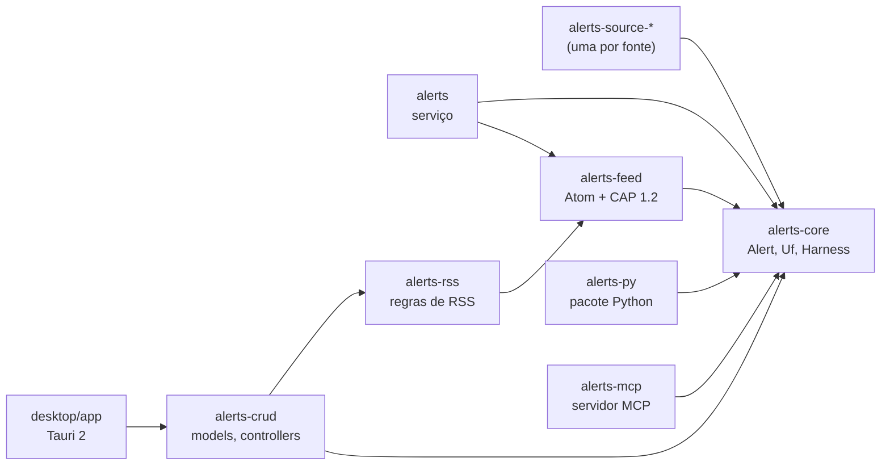
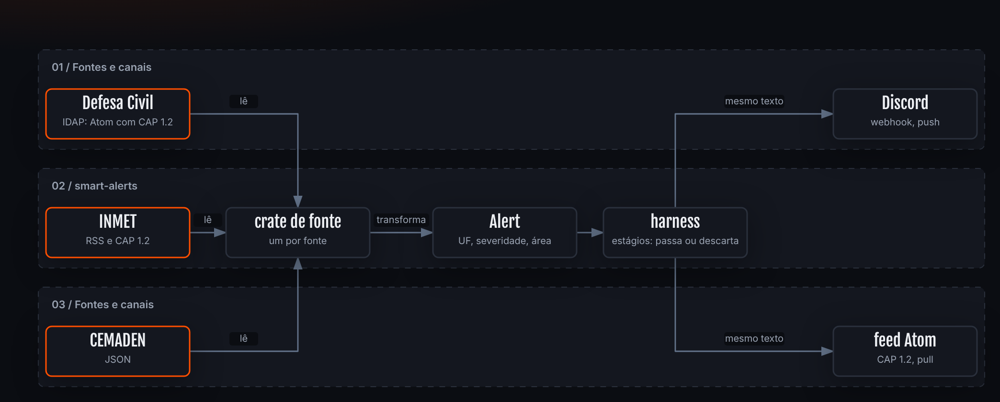

<!-- reading-time: 14 min -->
# alerts

🇬🇧 [Read in English](README.md)

|  | <a href="https://www.desmos.com/calculator/z7zooq9zsh"></a> |
|:---:|:---:|
| *Onda de Fibonacci*, Matheus Hoffmann ([@h0ffmann](https://github.com/h0ffmann)), 2026 | [*Ammonite*](https://www.desmos.com/calculator/z7zooq9zsh), Harry Chen ([@harry7557558](https://github.com/harry7557558)), 1º lugar no concurso de arte do Desmos de 2021 |
| Fonte Desmos: [`wave.desmos.json`](docs/drawings/wave.desmos.json) | Fonte Desmos: [`desmos.com/calculator/z7zooq9zsh`](https://www.desmos.com/calculator/z7zooq9zsh) |

Alertas do século 22.

## em um minuto

- **O alerts é uma plataforma de alertas genérica.** Ele coleta alertas de fontes oficiais,
  filtra os alertas e entrega os alertas. Um risco, uma região ou um canal é um módulo: o núcleo
  não muda quando alguém adiciona um módulo.
- **Só fontes oficiais.** Um alerta vem de um órgão oficial. O alerts nunca inventa um alerta,
  uma área, um horário ou uma ação que a fonte não diz.
- **O primeiro risco é inundação no Brasil.** A v0 atende a Região Sul: Paraná (PR),
  Santa Catarina (SC) e Rio Grande do Sul (RS).
- **A v0 entrega um serviço para Discord** e um feed Atom com alertas CAP 1.2, com os mesmos
  alertas e o mesmo texto. O pacote Python `piabrota-alerts` existe desde o
  início. Um plugin AstrBot vai usar esse pacote no futuro.
- **Aberto por princípio.** Padrões abertos (Atom, CAP 1.2), só dependências FOSS, só modelos
  locais. Uma API paga nunca é obrigatória.
- **Estado:** bootstrap. Nenhuma fonte de um órgão está implementada. O serviço envia uma mensagem
  de teste. O comando `alerts poll mock` envia alertas simulados de teste ao Discord e ao feed, pelo harness.

## fontes

Os dados do Brasil estão espalhados. Cada fonte é um módulo próprio: adicionar uma fonte não
muda o núcleo.

Verificação de 2026-10-22. Cada endpoint foi acessado duas vezes: de dentro do Brasil (`curl`) e
de fora do Brasil (um cliente HTTP em servidor no exterior). Nenhuma fonte bloqueia acesso por
país. Nenhuma fonte publica regra sobre acesso estrangeiro. O endpoint, o formato e a autenticação de
cada fonte estão em [`docs/SOURCES.md`](docs/SOURCES.md).

| Fonte | API oficial | Formato | Autenticação | Fora do Brasil | Versão |
|---|---|---|---|---|---|
| Defesa Civil (IDAP) | sim, sem documentação ⚠ | Atom com CAP 1.2 | nenhuma | acessível | v0 |
| INMET | sim | RSS e CAP 1.2; JSON sem documentação | nenhuma (avisos); token por e-mail (estações) | acessível | v0 |
| CEMADEN | sim (observações) | REST JSON | cadastro gratuito (JWT) | acessível | v0 |
| ANA | sim | REST JSON; SOAP legado | cadastro com CPF/CNPJ (REST); nenhuma (SOAP) | acessível; o cadastro pode exigir CPF/CNPJ ⚠ | planejada |
| CPTEC/INPE | sim, só previsão | XML | nenhuma | acessível; uso não comercial | planejada |
| Epagri/Ciram (SC) | parcial | RSS e JSON do WordPress, texto livre | nenhuma (avisos); CPF (dados de estação) | acessível | planejada |
| SGB (SACE) | não | HTML; boletins em PDF | nenhuma | acessível | planejada |
| Defesa Civil RS | não | PDF; JSON do ClimaRS sem documentação | nenhuma | acessível | planejada |
| SIMEPAR (PR) | não encontrada | — | — | bloqueado em qualquer país (Cloudflare) | planejada |

**O que cada fonte exige do código:**

- **Defesa Civil (IDAP):** o feed `idapfile.mdr.gov.br/idap/api/rss/cap` guarda cerca de 12 horas
  de alertas ⚠ e tem cerca de 10 MB. O módulo deve consultar o feed com frequência e guardar os
  alertas. Os alertas de PR, SC e RS aparecem nesse feed. A Defesa Civil de SC também publica um
  RSS em texto livre.
- **INMET:** `apiprevmet3.inmet.gov.br` derruba a conexão quando o User-Agent é o padrão do curl
  (`curl/...`). O alerts se identifica com o próprio nome (`piabrota-alerts/<versão>`).
  O INMET aceitou esse User-Agent com o nome antigo do projeto em 2026-10-22. Ninguém conferiu o
  nome novo ⚠. O RSS declara domínio público, com citação da fonte.
- **CEMADEN:** a API PED (`sws.cemaden.gov.br/PED`) entrega observações, não alertas. Os alertas
  municipais só existem num JSON sem documentação (`painelalertas.cemaden.gov.br/wsAlertas2`). O
  limite é de 12 requisições por minuto para usuário externo ⚠. O CEMADEN exige citação.
- **ANA:** o token do REST vale 60 minutos. Pedidos de token frequentes podem bloquear o IP.
- **CPTEC/INPE:** os termos proíbem uso comercial sem autorização e exigem a citação
  "CPTEC/INPE". O serviço não tem avisos.
- **Defesa Civil RS:** substituiu a Sala de Situação da SEMA-RS em fevereiro de 2025. O JSON do
  ClimaRS (níveis de rio da ANA) pode mudar sem aviso.
- **SIMEPAR:** nenhum cliente automático passa pelo desafio da Cloudflare. A fonte fica sem módulo
  até o SIMEPAR publicar uma API.

## modelos locais

Algumas fontes publicam texto livre (boletins, PDFs). Para essas fontes, o alerts vai usar
modelos abertos que rodam na máquina local. Uma API paga nunca é obrigatória.

| Runtime | Licença | Uso no alerts | Estado |
|---|---|---|---|
| [Ollama](https://github.com/ollama/ollama) | MIT | Ler texto livre e extrair campos (local, hora, nível do rio) para um `Alert`. | planejado |
| [OLLAYA](https://github.com/ollaya-dev/ollaya) | Apache-2.0 | Decidir: perguntas tipadas (é alerta de inundação? qual severidade?) com probabilidade calibrada. Não gera texto. | em breve |

Um modelo nunca inventa alerta. Quando o modelo não tem certeza, o alerta volta para o harness
determinístico e fica marcado para revisão humana.

## canais

| Canal | Padrão | Entrega |
|---|---|---|
| Discord | webhook do Discord | push |
| Feed | Atom (RFC 4287) com CAP 1.2 (OASIS) em cada entrada | pull |

Os dois canais leem a mesma saída do harness: um alerta que chega ao Discord também chega ao
feed, com o mesmo texto. O feed não depende de empresa: Atom e CAP são padrões abertos. O feed
tem o mesmo formato do feed nacional da Defesa Civil (IDAP), e qualquer leitor de feed abre o
arquivo. Um alerta de teste sai com `<status>Test</status>`.

## quem vai usar o alerts

| Consumidor | O que é | Como lê o alerts | Situação |
|---|---|---|---|
| Discord | O servidor da v0, que já existe | webhook (push) | v0 |
| Qualquer leitor de feed | Atom (RFC 4287) com CAP 1.2 em cada entrada | o arquivo do feed (pull) | v0 |
| [Obsidian](https://obsidian.md) | O plugin WeatherDisaster: uma nota por alerta, para um segundo cérebro | o feed (pull) | novo |
| [AstrBot](https://github.com/AstrBotDevs/AstrBot) | Plataforma livre de chatbot para apps de mensagem (AGPL-3.0) | o pacote Python `piabrota-alerts` num plugin | planejado |
| [astrbot_plugin_disaster_warning](https://github.com/Pancakes-Labs/astrbot_plugin_disaster_warning) | Plugin de alertas de desastre para o AstrBot: terremoto, tsunami, tempo (AGPL-3.0) | o pacote Python ou o feed, para alertas do Brasil | planejado |

Um plugin chama o pacote: o alerts não copia código AGPL. Mais em
[`docs/REFERENCES.md`](docs/REFERENCES.md).

## arquitetura



<details open>
<summary>Como ler esta figura</summary>

**Em uma frase.** Todo crate depende do `alerts-core`. O núcleo não depende de nenhum crate.

**Como ler.** Cada seta vai do crate que usa para o crate usado.

**Fora da figura.** As crates de fonte ainda não existem. O gerador `alerts-scaffold` escreve código no `alerts-crud` e não depende de nenhum crate. O harness compõe estágios puros
(`Fn(Alert) -> Option<Alert>`): veja `GROUND_TRUTH.md`.

**Evidência.** `Cargo.toml` de cada crate em `crates/` e em `desktop/`.

</details>

### o caminho de um alerta



<details open>
<summary>Como ler esta figura</summary>

**Em uma frase.** Um alerta oficial segue um caminho só, e o Discord e o feed recebem o mesmo texto.

**Como ler.** Da esquerda para a direita. Uma caixa laranja é uma fonte oficial. Cada seta diz o
que acontece.

**Fora da figura.** As fontes planejadas, os modelos locais e os alertas que o harness descarta.

**Evidência.** As seções fontes, canais e arquitetura deste README. Nenhum crate de fonte existe
ainda. A fonte: [`docs/archify/fluxo-alerta.json`](docs/archify/fluxo-alerta.json).

</details>

## usar

```console
nix develop
just check                                  # formatação, clippy, testes, licenças
DISCORD_WEBHOOK_URL=... just test-message   # envia uma mensagem de teste ao Discord
FEED_PATH=alerts.atom just test-message     # grava o feed Atom + CAP 1.2 com um alerta de teste
MAROLA_DISCORD_WEBHOOK_URL=... just marola-discord   # um alerta de teste ao Discord oficial do Marola
just obsidian                               # gera o plugin WeatherDisaster do Obsidian
just mcp                                    # servidor MCP em stdio
just py-build                               # gera o pacote Python
just reading-time                           # grava o tempo de leitura de cada arquivo para humanos
just figure                                 # desenha docs/archify/*.json com o Archify
just graph                                  # o grafo do código: build/graph/graph.html
just site                                   # o site estático de piabrota.art/alerts/
just desktop-dev                            # o app desktop (Tauri 2), com recarga ao vivo
just generate scaffold rivers slug:slug name:string   # um recurso CRUD novo no alerts-crud
```

## app desktop

O app desktop configura os apps numa janela: as fontes, os canais e os apps. Ele segue as convenções
de CRUD do Loco: cada recurso tem um model, um controller e uma migration. O app também lista os
alertas que as fontes entregaram, ao lado de um mapa. O app nunca cria um alerta.

- `crates/alerts-crud`: os models, os controllers e as migrations, em SQLite. Toda operação passa
  por `controllers::dispatch`.
- `crates/alerts-rss`: o combinador de RSS. Cada usuário tem áreas, projetos e tarefas, e cada um
  deles tem feeds RSS e regras que combinam os feeds. Veja [`docs/RSS.md`](docs/RSS.md).
- `desktop/app`: o Tauri 2. Os dois comandos dele (`modules`, `crud`) chamam o `alerts-crud`.
- `desktop/ui`: a interface, em Rust (Leptos, compilado para wasm32). A interface desenha cada página
  a partir da spec de um recurso. Um recurso do `just generate scaffold` ganha a página sem código de interface.
- O mapa usa o MapLibre GL JS 5.24.0 e os tiles do OpenFreeMap: sem chave e sem conta.


Mais em [`docs/DESKTOP.md`](docs/DESKTOP.md).

## plugin do Obsidian

O WeatherDisaster (id `piabrota-alerts`) leva os alertas oficiais para um cofre do Obsidian. O
plugin lê um feed Atom ou RSS de alertas CAP 1.2 e grava uma nota por alerta. O frontmatter tem os
campos CAP, e o texto do emissor fica literal. Um `Update` do CAP reescreve a nota, e um `Cancel`
do CAP marca a nota como cancelada. Os filtros são UF, município do IBGE e severidade mínima. Uma
leitura que falha aparece como falha, nunca como "nenhum alerta". A lógica é Rust
(`crates/alerts-obsidian`), compilada para WebAssembly.

Mais em [`docs/OBSIDIAN.md`](docs/OBSIDIAN.md) (em inglês).

## documentação

A documentação existe em quatro idiomas: pt-BR, inglês, chinês e japonês. As páginas estão em
`wiki/`. A Wiki do GitHub só recebe as páginas depois que o repositório for público (issue #1).
As ideias para hospedar o site em `piabrota.art/alerts` estão em [`docs/HOSPEDAGEM.md`](docs/HOSPEDAGEM.md).

## créditos

- A calculadora de tempo de leitura, o fluxo de figuras e as ferramentas do site vêm do
  [ptbr-writer](https://github.com/h0ffmann/ptbr-writer) e dos labs do picasso (ptbr-tools,
  code-graph, gleam-website). As figuras são desenhadas com o [Archify](https://github.com/tt-a1i/archify),
  de @tt-a1i (MIT). O grafo do código usa o esquema do [graphify](https://github.com/Graphify-Labs/graphify).
- O layout do README em inglês vem do [picasso](https://github.com/h0ffmann/picasso).
- O desenho é de Matheus Hoffmann ([@h0ffmann](https://github.com/h0ffmann)). O render sai das
  expressões do Desmos. A onda junta a espiral de Fibonacci e *A Grande Onda de Kanagawa*, de Katsushika Hokusai
  (c. 1831). Outros artistas desenharam ondas de Fibonacci antes: os créditos estão em [`docs/drawings/README.md`](docs/drawings/README.md).
- As convenções de app (geradores, doctor, agendador, tarefas) seguem o [Loco](https://loco.rs)
  (Apache-2.0). As capturas de tela do bootstrap estão em [`docs/screenshots/loco-bootstrap/`](docs/screenshots/loco-bootstrap).
  O layout de CRUD do `alerts-crud` (models, controllers, migrations, scaffold) também segue o Loco.
- O mapa do app desktop usa o [MapLibre GL JS](https://maplibre.org) (BSD-3-Clause), os tiles do
  [OpenFreeMap](https://openfreemap.org) e dados do OpenStreetMap (ODbL). O app desktop usa o [Tauri](https://tauri.app)
  (Apache-2.0 ou MIT) e o [Leptos](https://leptos.dev) (MIT).

- O harness funcional traduz o
  [Object-Oriented Harness](https://arxiv.org/abs/2610.28380) (arXiv 2610.28380) para composição
  de funções.
- A escrita em pt-BR segue o [ptbr-writer](https://github.com/h0ffmann/ptbr-writer). O verbo `open-pr` é a skill
  [`bipr`](https://github.com/h0ffmann/ptbr-writer/blob/main/skills/bipr/SKILL.md) dele, adaptada (MPL-2.0).
- A escrita em inglês segue o modelo do ASD-STE100.
- O japonês segue o japonês fácil (Yasashii Nihongo).

## como citar

Use o [`CITATION.cff`](CITATION.cff), com o commit ou a tag usada. O [`REUSE.toml`](REUSE.toml)
dá a licença e o copyright de cada arquivo, e as regras de citação para agentes.

## licença

[MPL-2.0](LICENSE).
