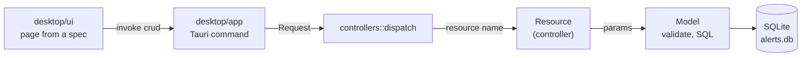

<!-- reading-time: 6 min -->
# The desktop app

The desktop app is a window to configure alerts apps and to read the delivered alerts. It is
Tauri 2 around the Loco-style CRUD of `crates/alerts-crud`. The interface is Rust too: Leptos,
compiled to wasm32.

The app never creates an alert. An alert comes only from an official source, through
`alerts_crud::models::alerts::record`. The interface can read and delete an alert.

## Run it

```console
nix develop
just desktop-dev      # trunk serves desktop/ui on :1420, and Tauri opens it
just desktop-build    # desktop/target/release/alerts-desktop, with the interface inside
just desktop-check    # format, clippy (the interface for wasm32), licenses; part of `just check`
```

- The database is `alerts.db` in the app data directory of the system. `ALERTS_DB=<file>` names
  another file, for example a copy to test with.
- `just desktop-vendor` gets MapLibre GL JS 5.24.0 with `npm pack`, which checks the npm
  integrity hash. The files go to `desktop/ui/vendor/`, and git ignores them.
- On Linux, Tauri needs WebKitGTK 4.1. The dev shell of `flake.nix` has it.

## Layout

| Path | Loco equivalent | Job |
|---|---|---|
| `crates/alerts-crud/src/models/` | models | One file per resource: the record, its params, its checks, its spec |
| `crates/alerts-crud/src/controllers/` | controllers | One file per resource: the default CRUD, or more logic |
| `crates/alerts-crud/src/migrations/` | migrations | One file per schema change, applied in order |
| `crates/alerts-scaffold/` | `cargo loco generate scaffold` | Writes the three files of a new resource |
| `desktop/app/` | the server | Tauri 2: the window and two commands |
| `desktop/ui/` | the views | The interface: one page per resource spec, and the map |

## The path of a request



<details open>
<summary>How to read this figure</summary>

**In one sentence.** Every operation goes through one function, `controllers::dispatch`.

**How to read.** Left to right. Each arrow is labelled with what goes to the next box.

**Not shown.** The `modules` command, which returns the specs. The errors, which go back the same
path as JSON with a `kind` tag.

**Evidence.** `desktop/app/src/main.rs` and `crates/alerts-crud/src/controllers/mod.rs`.

</details>

## The resources

| Resource | Operations | Notes |
|---|---|---|
| `alerts` | list, show, delete | Written only by a source module. Same `(source, id)`: one record. |
| `apps` | CRUD, `app_toml` | Each source and each channel must exist. `app_toml` gives the `apps/<app>/app.toml` of the `manage-apps` skill. `App::harness` builds the harness. |
| `sources` | CRUD | `slug` is the id of the source crate. `poll_every` is `every <N><s, m or h>`. |
| `channels` | CRUD | `target_env` names the environment variable of the target. The secret is never in the database. |
| `users`, `areas`, `projects`, `tasks` | CRUD, `para` on users | The PARA tree of each user. See `docs/RSS.md`. |
| `feeds`, `rules`, `feed_items` | CRUD, `atom` on rules; items are read-only | The RSS combinator. See `docs/RSS.md`. |

A check that fails returns the field and a pt-BR message. The form shows the message under its
input.

## A new resource

```console
just generate scaffold rivers slug:slug name:string site:url level:int note:string?
```

1. The command writes `models/rivers.rs`, `controllers/rivers.rs` and a migration.
2. It registers the three modules at the `// scaffold:` markers.
3. The interface shows the new page. It needs no change, because it draws the page from the spec.
4. You write the pt-BR labels of `SPEC` and any other check.

The kinds are `string`, `string?` (optional), `text`, `url`, `slug`, `bool` and `int`. A migration
never changes after its merge. A change to the schema is a new migration.

## The map

The map page uses MapLibre GL JS and the OpenFreeMap tiles: no key and no account. The
attribution shows. `alerts_core::Alert` has only the area as text, so the map draws no shape: a
guessed shape is not allowed (the `map` skill). The list next to the map gives the area of each
alert in text. A geometry field in the core is the next step.

## Screenshots

Taken on 2026-10-27 from the release build (`just desktop-build`) under Xvfb, at 1200 × 780
pixels. The data is the example app of the `manage-apps` skill and the test alert of
`just test-message`. The network of the test machine blocks the tile server, so the map shows no
base map. Nobody checked the base map on an open network ⚠.

| Screenshot | Page |
|---|---|
| [`alerts.png`](screenshots/desktop/alerts.png) | Alerts: read-only, with the test alert |
| [`apps.png`](screenshots/desktop/apps.png) | Apps: the table |
| [`edit.png`](screenshots/desktop/edit.png) | Apps: the edit form, with choices and references |
| [`invalid.png`](screenshots/desktop/invalid.png) | Apps: the field errors from the controller |
| [`app-toml.png`](screenshots/desktop/app-toml.png) | Apps: the `app_toml` action |
| [`sources.png`](screenshots/desktop/sources.png) | Sources: the table |
| [`map.png`](screenshots/desktop/map.png) | Map: MapLibre, with no tiles on the test machine, and the alert list |
