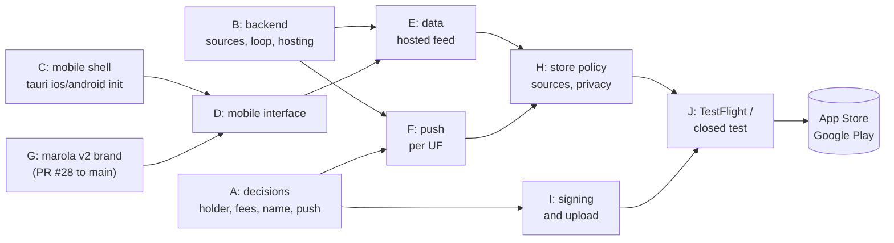

<!-- reading-time: 11 min -->
# STORES: how far marola alertas is from the App Store and Google Play

Checkpoint of 2026-10-27, at `main` `051211a`. This page maps the work to publish the alerts app
as **marola alertas** on the Apple App Store and on Google Play. `READINESS.md` maps release 0 of
the service. This page starts where it stops. Update it at each checkpoint: change a status only
after you check it, and keep each `⚠`.

## Verdict

**Not ready, and the first blockers are not code.** No mobile build exists. A phone app also needs
three things that do not exist yet:

- a hosted service that publishes real alerts
- an account holder with a legal identity
- an explicit "yes" to the store fees, because of the hard rule "FOSS first"

The engineering is large but well understood: Tauri 2 builds the same Rust and Leptos code for iOS
and Android.

| Area | App Store | Google Play | Status |
|---|---|---|---|
| A: Decisions: account holder, fees, name, push provider | needed | needed | **blocked** on a person |
| B: Backend: real sources, service loop, hosted feed | needed | needed | **missing** (`READINESS.md` items 1 to 3) |
| C: Mobile shell: `tauri ios init`, `tauri android init`, builds | needed | needed | **missing** |
| D: Mobile interface: the map and the list on a phone | needed | needed | **missing** (desktop only) |
| E: Data on the phone: read the hosted feed | needed | needed | **missing** |
| F: Notifications: push per UF | needed (and the main answer to guideline 4.2 ⚠) | needed | **missing** |
| G: Brand: marola v2 strip, logo, about page | needed | needed | **stranded**: PR #28 was merged into `feat/mapa-inicio`, not `main` |
| H: Store policy: sources, disclaimer, privacy | needed | needed | **missing** |
| I: Signing and upload, by hand (no CI) | needed | needed | **missing** |
| J: Testing gate before production | TestFlight | 12 testers for 14 days (personal account) | **missing** |

Legend: **done** (on `main`), **in progress** (an open PR), **stranded** (merged, but not on
`main`), **blocked** (waits on a person or a choice), **missing** (nobody started it).

## The map

How to read this figure

**In one sentence.** Two roots block everything: the decisions (A) and the backend (B). The
mobile shell (C) can start today.

**How to read.** Left to right. An arrow means "must exist before".

**Not shown.** The order inside each box. The FOSS route (F-Droid), which skips I and J but not B.

**Evidence.** This page, `READINESS.md`, `desktop/app/tauri.conf.json`, `docs/DESKTOP.md`.

## What exists today

- **The desktop app** (`desktop/`, `docs/DESKTOP.md`). Tauri 2 around the `alerts-crud`
  controllers, with a Leptos interface compiled to wasm32. The home page is the MapLibre map (#27).
- **Where its alerts come from.** A local SQLite file that `alerts poll` fills from the outside.
  A phone has no `alerts poll` next to it.
- **Its identifier.** `art.piabrota.alerts` (`desktop/app/tauri.conf.json`). The window has a
  minimum width of 820 px, so the layout is desktop only.
- **The marola v2 brand** (PR #28): the marola.dev strip, the GitHub pills, logo v2, the about
  page and the marola.dev areas. It was merged into the branch of #27 after #27 reached `main`, so
  `main` does not have it. A PR from `feat/mapa-inicio` (or a cherry-pick of `3ed87b3`) to `main`
  brings it back.
- **No real source.** `READINESS.md`: only the mock source and the test message exist.

## A: Decisions for a person

Nothing here can be decided by an agent. Each item changes what gets built.

| Decision | Why it matters | Facts checked on 2026-10-27 |
|---|---|---|
| **Who publishes** | The store listing names the developer. | Apple waives its fee only for a legal entity with nonprofit, accredited educational or government status, and never for an individual or sole proprietor. A Google Play organization account needs a D-U-N-S number, and it skips the closed-testing gate of J. marola calls itself non-profit; nobody checked whether a registered Brazilian entity exists ⚠. |
| **The fees** | The hard rule "FOSS first" forbids paid resources without explicit human confirmation. | Apple: 99 USD per year, unless waived. Google: a one-time 25 USD. |
| **Name and identifier** | The identifier cannot change after the first publication ⚠ (common knowledge; nobody checked the store pages for this page). | Today: `art.piabrota.alerts`. A marola name (for example `dev.marola.alertas`) fits the brand; it needs the owner of `marola.dev`. |
| **Push provider** | Push needs a server and an account at each provider. | iOS: APNs only. Android: FCM (a Google service, not free software) or UnifiedPush (free software, works on F-Droid). |
| **The FOSS route first?** | F-Droid needs no fee and no store review. | Since 2026-09-30, Android in Brazil checks that a sideloaded app comes from a registered developer. That covers F-Droid installs too ⚠ (the reports differ on the details). |

## B: Backend

This is `READINESS.md` "Missing for release 0", items 1 to 3. A store app that shows only `TESTE`
alerts is an empty app. A reviewer can reject it as incomplete ⚠ (App Store guideline 2.1;
nobody reread it for this page).

1. One real v0 source (Defesa Civil IDAP first), then CEMADEN and INMET.
2. `alerts run`: poll, store, and deliver each id once.
3. Hosting: the Atom + CAP 1.2 feed over HTTPS, and later the push sender. It must be free, or a
   person confirms the cost.

## C: Mobile shell

- `tauri ios init` and `tauri android init` generate the native projects. iOS needs a Mac and
  Xcode, and this machine is a Mac. Android needs the Android SDK and the NDK, and the dev shell
  of `flake.nix` does not have them yet.
- `trunk` needs rustc 1.96. The default toolchain here is 1.78, and `nix` is not installed. This
  blocked the desktop build too (#27, #28).
- Google Play: new apps and updates must target API level 36 (Android 16) since 2026-08-31.
  Tauri's minimum is Android 7 (SDK 24) by default.
- Recipes, never CI (hard rule "No CI"): `just mobile-android` and `just mobile-ios`, run by hand.

## D: Mobile interface

The desktop interface is built for a mouse and a wide screen:

- The 220 px menu and the 360 px list become a full-screen map and a bottom sheet with the list.
- The hover box over a UF does nothing on a touch screen. A tap opens the summary instead.
- The CRUD pages (apps, sources, channels) are operator tools. They stay out of the phone build.
  The phone app has the map, the list, the about page and the notification settings.
- The marola look comes from G: the `marola-site` `DESIGN.md` tokens, and the 44 px touch rows it
  already uses on phones.

## E: Data on the phone

- The phone reads the hosted Atom + CAP 1.2 feed (B3), not SQLite. Every request sends
  `alerts_core::USER_AGENT` (hard rule "Identify honestly"). The CSP gets the feed host.
- Keep the last feed on the phone, and show its age: "lidos às 14:05". Offline, the app says it
  is offline and never shows an empty list as "no alert". This is the promise "Diz quando não
  sabe".

## F: Notifications

- The user subscribes to UFs. The server sends one push per new alert id, with the same pt-BR
  text as Discord and the feed (the parity rule of `GROUND_TRUTH.md`).
- **Plugins.** Tauri has no official push plugin that this page could find ⚠. Community plugins
  exist: `tauri-plugin-notifications` (APNs, FCM, UnifiedPush) and `tauri-plugin-mobile-push`
  (APNs, FCM). Check that the plugin is still maintained, and run `just deny` on it.
- **iOS Critical Alerts** (sound through silent mode). An entitlement that Apple grants on request
  for health, home security and public safety apps. Severe-weather apps fit the public-safety
  category, but the forums report refusals ⚠. Time Sensitive notifications need no entitlement.
  Apply only for `Extreme`, after the app is live.
- Push is also the main answer to App Store guideline 4.2 ("Minimum Functionality"). A web view
  that only shows a map is the classic rejection ⚠ (from developer reports, not Apple's page).

## G: Brand

Bring PR #28 to `main` first. Then:

- the app icon, made from logo v2 with `tauri icon`, with CC BY 4.0 credit (the about page of
  #28 credits it)
- the store name "marola alertas"
- screenshots from the phone build, with simulated `TESTE` alerts, labelled as simulations

## H: Store policy

- **Government information (Google Play).** An app that is not a government app but shows
  government information must name its sources and say clearly that it does not represent the
  government. Put both in the store description and in the about page: Defesa Civil, INMET and
  CEMADEN, with links, and "o marola não é um canal oficial do governo". A 2024 news report says Google removed an
  app over a missing disclaimer ⚠ (secondary source).
- **Not a replacement.** The about page and the description say that the official warnings come
  from Defesa Civil, and that the app can be late or down.
- **Privacy.** Both stores need a privacy policy and a privacy form: Apple's App Privacy answers
  and Google's Data safety form. The app collects no account. The push token and the chosen UFs are
  data that the server stores, so the forms must say so. The policy follows the LGPD, and marola.dev
  promises "sem cookies e sem rastreamento".
- **Licenses.** MPL-2.0 for the code, plus the credits for MapLibre, OpenFreeMap, OpenStreetMap
  (ODbL), IBGE and logo v2 (CC BY 4.0), on the about page.

## I: Signing and upload

- Android: an upload key, outside the repo (hard rule "No secrets in the repo"). The first AAB
  goes up by hand in the Play Console, so Google can check the signature and the package name.
  The command is `tauri android build --aab`.
- iOS: `tauri ios build --export-method app-store-connect`, then `xcrun altool --upload-app` with
  an App Store Connect API key, outside the repo.
- Both run by hand, from a recipe.

## J: Testing gate

- **Google Play, personal account** (created after 2023-11-13): a closed test with at least 12
  testers, opted in for 14 days without a break, before production. An organization account is
  exempt. Ask the Marola Discord for testers.
- **App Store:** TestFlight. Apple reviews the first external build.

## Phases

1. **Decide** (A). Account holder, fees, name, push provider, FOSS route first or not.
2. **Bring the brand to `main`** (G). A PR with `3ed87b3`.
3. **Release 0 of the service** (B). Tracked in `READINESS.md`.
4. **Mobile shell and interface** (C, D). This can start before B ends, with the mock source.
5. **Feed and push** (E, F).
6. **Policy texts** (H). Privacy policy, disclaimer and store descriptions in pt-BR, with
   bilingual review.
7. **Android first** (I, J). The fee is lower, and the closed test takes the longest.
8. **iOS** (I, J). TestFlight, then review. Apply for Critical Alerts only after launch.

## Checklist

- [ ] Choose the account holder (a person or a nonprofit entity), and record it here
- [ ] Confirm the store fees in writing (hard rule "FOSS first"), or ask Apple for the fee waiver
- [ ] Choose the name and the identifier (permanent)
- [ ] Choose the push provider (APNs + FCM, or APNs + UnifiedPush)
- [ ] Bring PR #28 (`3ed87b3`) to `main`
- [ ] Release 0 of the service with one real source and a hosted feed (`READINESS.md`)
- [ ] rustc ≥ 1.96 or `nix` on the build machine, and the Android SDK and NDK in `flake.nix`
- [ ] `tauri android init`, `tauri ios init`, `just mobile-android`, `just mobile-ios`
- [ ] Phone layout: full-screen map, bottom sheet, tap instead of hover, no CRUD pages
- [ ] Read the hosted feed, cache it, and show its age
- [ ] Push per UF, with a plugin that passes `just deny`
- [ ] Privacy policy, government-information disclaimer, store descriptions
- [ ] Icons from logo v2, phone screenshots
- [ ] Target API 36, an upload key outside the repo, the first AAB by hand
- [ ] Closed test with 12 testers for 14 days (personal account only)
- [ ] TestFlight, then App Store review
- [ ] After launch: the Critical Alerts entitlement request

## Sources

Read on 2026-10-27.

- Apple fee waiver: <https://developer.apple.com/support/fee-waiver>
- Tauri, App Store: <https://v2.tauri.app/distribute/app-store/>
- Tauri, Google Play: <https://v2.tauri.app/distribute/google-play/>
- Google Play target API level: <https://developer.android.com/google/play/requirements/target-sdk>
- Google Play testing for new personal accounts: <https://support.google.com/googleplay/android-developer/answer/14151465>
- Google Play, apps with government information: <https://support.google.com/googleplay/android-developer/answer/9514050>
- Android developer verification, Brazil from 2026-09-30: <https://thehackernews.com/2026/06/google-sets-sept-30-deadline-for.html>, <https://f-droid.org/pt_BR/2026/02/24/open-letter-opposing-developer-verification.html>
- Critical Alerts entitlement: <https://developer.apple.com/forums/thread/106042>
- Push plugins: <https://github.com/Choochmeque/tauri-plugin-notifications>, <https://github.com/yanqianglu/tauri-plugin-mobile-push>
- Guideline 4.2 and web wrappers (secondary): <https://www.mobiloud.com/blog/app-store-review-guidelines-webview-wrapper>
