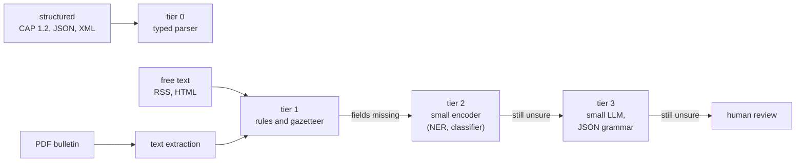

# Survey: small FOSS NLP tools for alert ingestion and publishing

This survey lists free and open-source NLP tools that are small enough to run on one cheap
machine (CPU only, a few GB of RAM). The goal: ingest and publish alerts at the lowest cost per
alert, without a paid API.

Sizes and licenses were read on 2026-10-22 from GitHub release assets, the GitHub license API
and the Hugging Face model API. A size is the download, not the memory at run time.

## The cost ladder

Use the cheapest tier that does the job. Each tier is a `Stage` in the harness. A stage at a
higher tier runs only on the alerts that the lower tiers could not handle.

How to read this figure

**In one sentence.** Structured sources never reach a model. Free text climbs the ladder only
until a tier fills the fields.

**How to read.** From left to right. An arrow label is the condition to go up one tier.

**Not shown.** Publishing tools (the text check and translation) are after the harness, in the
last section.

**Evidence.** The formats are in [`SOURCES.md`](SOURCES.md). The tier tools are in the tables
below.

| Tier | Cost per alert | Typical tools |
|---|---|---|
| 0: typed parser | microseconds | `quick-xml`, `serde_json` |
| 1: rules and gazetteer | microseconds | `regex`, `aho-corasick`, IBGE municipality list |
| 2: small encoder | tens of ms on CPU ⚠ | GLiNER, GLiClass, embeddings (ONNX) |
| 3: small LLM | seconds on CPU ⚠ | llama.cpp with a 0.8B model and a JSON grammar |

The per-alert costs are orders of magnitude, not measurements ⚠. Measure them with real alerts
before choosing a tier.

**What this means for v0.** The three v0 sources publish structured data: IDAP and INMET in
CAP 1.2, CEMADEN in JSON (see `SOURCES.md`). v0 needs tier 0 and tier 1 only. Tiers 2 and 3 are
for the planned free-text sources: Epagri/Ciram (RSS), SGB and Defesa Civil RS (PDF).

## Ingestion

### Tier 0: structured formats

| Tool | License | Form | Use |
|---|---|---|---|
| [`quick-xml`](https://github.com/tafia/quick-xml) | MIT | Rust crate | CAP 1.2, Atom, RSS, CPTEC XML, ANA SOAP |
| `serde_json` (already in the workspace) | MIT or Apache-2.0 | Rust crate | CEMADEN, INMET JSON, ClimaRS |

### Text from HTML and PDF

| Tool | License | Form | Use | Verdict |
|---|---|---|---|---|
| [`scraper`](https://github.com/rust-scraper/scraper) | ISC | Rust crate | HTML pages (SGB, Defesa Civil RS, PR) | use |
| [`lopdf`](https://github.com/J-F-Liu/lopdf) | MIT | Rust crate | read PDF structure | use for simple PDFs |
| [`pdf-extract`](https://github.com/jrmuizel/pdf-extract) | MIT (Cargo.toml) | Rust crate | PDF to text | use for simple PDFs |
| [Docling](https://github.com/docling-project/docling) | MIT | Python, large | PDF layout and tables | only if bulletins have tables that the crates cannot read |

### Tier 1: rules and gazetteer

| Tool | License | Form | Use |
|---|---|---|---|
| `regex` | MIT or Apache-2.0 | Rust crate | dates, times, river levels (`cm`, `m`), warning numbers |
| [`aho-corasick`](https://github.com/BurntSushi/aho-corasick) | Unlicense or MIT | Rust crate | find every municipality name in a text in one pass |
| [IBGE localidades API](https://servicodados.ibge.gov.br/api/v1/localidades/estados/RS/municipios) | open government data | JSON | the gazetteer: name and IBGE code of each municipality (RS: 497 municipalities, read on 2026-10-22) |
| [`whatlang`](https://github.com/greyblake/whatlang-rs) | MIT | Rust crate, models built in | language check (is this Portuguese?) |
| [`lingua`](https://github.com/pemistahl/lingua-rs) | Apache-2.0 | Rust crate | more accurate language check; select only the languages you need to keep it small |

Normalize the text before matching: lower case, accents removed for the match key only, and the
original text kept. The IBGE code is the key, never the name: many names repeat across states.

### Tier 2: small encoders

| Tool or model | License | Size | Form | Use |
|---|---|---|---|---|
| [`ort`](https://github.com/pykeio/ort) | Apache-2.0 | ONNX Runtime library | Rust crate | run ONNX models on CPU |
| [`tract`](https://github.com/sonos/tract) | MIT or Apache-2.0 | small, pure Rust | Rust crate | run small ONNX models without a C++ runtime |
| [`candle`](https://github.com/huggingface/candle) | Apache-2.0 | pure Rust | Rust crate | run safetensors models without ONNX |
| [`gline-rs`](https://github.com/fbilhaut/gline-rs) | Apache-2.0 | — | Rust crate on `ort` | GLiNER in Rust |
| [GLiNER multi v2.1](https://huggingface.co/urchade/gliner_multi-v2.1) | Apache-2.0 | 1156 MB | model | zero-shot NER: municipality, river, time, level |
| [GLiClass small v1.0](https://huggingface.co/knowledgator/gliclass-small-v1.0) | Apache-2.0 | 575 MB (ONNX) | model | zero-shot classes: flood or not, severity |
| [`fastembed-rs`](https://github.com/anush008/fastembed-rs) | Apache-2.0 | — | Rust crate | embeddings |
| [multilingual-e5-small](https://huggingface.co/intfloat/multilingual-e5-small) | MIT | 471 MB | model | near-duplicate alerts from two sources |
| [paraphrase-multilingual-MiniLM-L12-v2](https://huggingface.co/sentence-transformers/paraphrase-multilingual-MiniLM-L12-v2) | Apache-2.0 | 471 MB | model | the same job, an alternative |

The sizes are the fp32 weights. A quantized ONNX export is usually several times smaller ⚠.

[OLLAYA](https://github.com/ollaya-dev/ollaya) (Apache-2.0) serves GLiClass, NLI and other
decision models behind one local API and an MCP server. Its CUDA build for Linux is 1391 MB.
Use it when you want the models as a service. Use `ort` or `gline-rs` when you want them inside
the smart-alerts binary.

### Tier 3: small LLM

| Tool or model | License | Size | Form | Use |
|---|---|---|---|---|
| [llama.cpp](https://github.com/ggml-org/llama.cpp) | MIT | 21 MB (`ubuntu-x64` build b11827) | single binary and HTTP server | run a GGUF model on CPU |
| [Qwen3.5-0.8B GGUF](https://huggingface.co/unsloth/Qwen3.5-0.8B-GGUF) | Apache-2.0 | 507 MB (`Q4_0`) | model | extract fields from free text into JSON |
| [Qwen3.5-2B](https://huggingface.co/Qwen/Qwen3.5-2B) | Apache-2.0 | 4548 MB (BF16) | model | the same job when 0.8B is not accurate enough |
| [Ollama](https://github.com/ollama/ollama) | MIT | 1435 MB (`linux-amd64`, with GPU libraries) | daemon | the same as llama.cpp, with model management |
| [llamafile](https://github.com/mozilla-ai/llamafile) | Apache-2.0 | 351 MB (0.10.6) | single executable | one file that runs on Linux, macOS and Windows |

Constrain the output. llama.cpp accepts a GBNF grammar or a JSON schema, so the model can only
return the fields of an `Alert`. This makes the output parseable and cuts the tokens. The stage
still checks that every value appears in the source text: a model never invents a field.

## Publishing

| Tool | License | Size | Form | Use | Verdict |
|---|---|---|---|---|---|
| Templates (`format!`) | — | — | Rust | the alert text, from the `Alert` fields | use: no model writes alert text |
| [Vale](https://github.com/vale-cli/vale) | MIT | 12 MB (3.25.1, Linux) | single binary | check the pt-BR text against `docs-pt-br` rules written as Vale styles | use, in `just check` for the templates |
| [Harper](https://github.com/Automattic/harper) | Apache-2.0 | 12 MB (2.13.0 CLI) | single binary | grammar check | English only ⚠: docs in EN only |
| [translateLocally](https://github.com/XapaJIaMnu/translateLocally) | MIT | — | desktop and CLI | offline translation (Bergamot models) | later: EN, ZH, JA alerts ⚠ model coverage not checked |
| [Argos Translate](https://github.com/argosopentech/argos-translate) | MIT | — | Python on CTranslate2 | offline translation | later, the same job |
| [CTranslate2](https://github.com/OpenNMT/CTranslate2) | MIT | — | C++ library | fast CPU inference for translation models | under Argos |

Vale is the cheapest publishing win: one 12 MB binary turns the `docs-pt-br` rules into a check
that runs on every template, with no model.

## Excluded

| Tool or model | Why |
|---|---|
| fastText language-identification model | CC-BY-NC-4.0: not free for commercial use. `whatlang` and `lingua` do the job. |
| spaCy `pt_core_news_sm` | Small (13 MB) and the spaCy code is MIT, but the model is CC-BY-SA-4.0 (share-alike) and needs Python. Tier 1 rules plus GLiNER cover the job. |
| Stanza | Apache-2.0, but Python and PyTorch: too heavy for one cheap machine. |
| `rust-bert` | Apache-2.0, but needs libtorch: too heavy. |
| LanguageTool | LGPL-2.1, but needs Java and a large download. Vale covers the controlled-language rules. |
| Llama and Gemma models | Their licenses are not OSI-approved. Qwen3.5 is Apache-2.0. |
| Any paid API | AGENTS.md: never required. |

## Recommendation

1. **v0:** tier 0 (`quick-xml`, `serde_json`) and tier 1 (`aho-corasick` with the IBGE
   gazetteer). No model. Add Vale for the alert templates.
2. **First free-text source (Epagri/Ciram):** add tier 2 with `gline-rs` and a quantized GLiNER,
   behind the deterministic stages.
3. **PDF sources (SGB, Defesa Civil RS):** `pdf-extract`, then tiers 1 and 2. Add tier 3
   (llama.cpp, Qwen3.5-0.8B, JSON grammar) only when tier 2 misses fields on real bulletins.
4. **Before each tier:** record real alerts as eval cases, and measure accuracy and time per alert.

## Not verified

- The per-alert costs in the ladder ⚠.
- The size of the quantized ONNX exports and of the ONNX Runtime library.
- Whether the Bergamot models cover pt-BR to ZH and JA.
- Whether Harper supports any language other than English.
