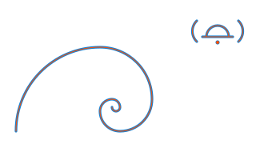

<!-- reading-time: 4 min -->
# Drawings

## `wave.svg`

A wave and an abstract bell, by Matheus Hoffmann ([@h0ffmann](https://github.com/h0ffmann)), 2026.
`wave.py` writes the drawing in two formats from one geometry:

| File | Command | What it is |
|---|---|---|
| `wave.svg` | `python3 docs/drawings/wave.py > docs/drawings/wave.svg` | The README drawing |
| `wave.desmos.json` | `python3 docs/drawings/wave.py desmos > docs/drawings/wave.desmos.json` | The same drawing as a Desmos graph state |

**The wave is a Fibonacci spiral.** It has eight quarter-circle arcs. The radii are
5 × (21, 13, 8, 5, 3, 2, 1, 1). Each arc fills one square of side 5 × Fₙ:
`python3 docs/drawings/wave.py squares` draws the squares.

**The bell** is a half circle (radius 14), a rim, a clapper dot and two sound arcs (radius 18).

**The default render is the Desmos render.** `wave.svg` draws the geometry in blue. On top, in
orange, it draws each expression of `wave.desmos.json`, sampled at 65 points. Where the two lines
agree, the orange line runs inside the blue line.

### Side by side

| ialerts wave | Ammonite |
|---|---|
|  |  |
| *Fibonacci wave*, Matheus Hoffmann ([@h0ffmann](https://github.com/h0ffmann)), 2026. MPL-2.0. | *Ammonite*, Harry Chen ([@harry7557558](https://github.com/harry7557558)), [Desmos graph](https://www.desmos.com/calculator/z7zooq9zsh). 1st place, 2021 Desmos Global Math Art Contest. |
| Desmos source: [`wave.desmos.json`](wave.desmos.json) | Desmos source: [`desmos.com/calculator/z7zooq9zsh`](https://www.desmos.com/calculator/z7zooq9zsh) |

- *Ammonite* is "a creature with a spiral shell and tentacles moving underwater", in the words
  of its author. It won the 2021 Desmos Global Math Art Contest, so it is a well-known sea graph.
  Desmos shows no likes or view counts, so "the most popular" cannot be measured ⚠.
- Source: [the list of Harry Chen's Desmos graphs](https://harry7557558.github.io/desmos/). The
  list says: "you are free to share and adapt graphs listed on this page, as long as appropriate
  attribution is given".
- This repository does not copy the graph or its picture. The table loads the picture from Desmos.
- ⚠ Not checked: the picture at the Desmos URL (Desmos could not be opened from the machine that
  wrote this page).

### Open the Desmos file

The file is a Desmos graph state (`version` 11), with parametric expressions only. Desmos uses
y up, so each y value is `180 - y` of the SVG.

1. Open `https://www.desmos.com/calculator`.
2. Open the browser console.
3. Run `Calc.setState(<the content of wave.desmos.json>)`.

⚠ Not checked: the Desmos page could not be opened when this file was made. The check was a
local one: `docs/screenshots/wave/desmos-overlay.png` draws each Desmos expression (orange) over
the SVG (blue), and the two match. Desmos is a free service but not FOSS: the file is data, and
smart-alerts does not depend on Desmos.

### Credits

The drawing is original. It joins two old ideas, and other artists joined them before:

- The Fibonacci sequence: Leonardo of Pisa (Fibonacci), *Liber Abaci*, 1202. The spiral of
  quarter circles in Fibonacci squares is a common construction.
- The wave as a spiral: Katsushika Hokusai, *The Great Wave off Kanagawa* (c. 1831), public
  domain. People often draw a Fibonacci spiral over it.
- Similar works by other artists, found on 2026-10-26 (not copied, not checked in detail ⚠):
  "Hokusai Meets Fibonacci" by cartogram and "The Great Fibonacci Wave" by Gypsy Queen, both on
  [TeePublic](https://www.teepublic.com/fibonacci-wave-merchandise).
