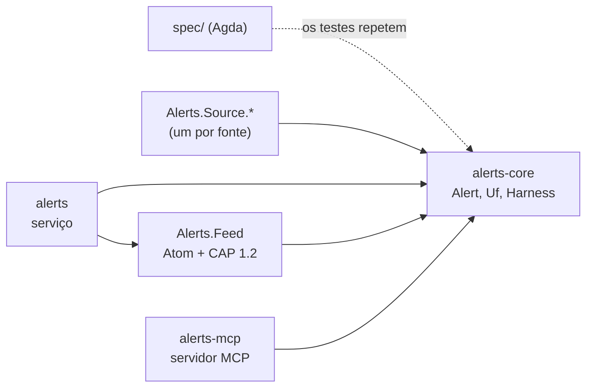

<!-- reading-time: 4 min -->
# Arquitetura

O código do alerts é Haskell, em pacotes do cabal em `haskell/`. O significado do código é uma
especificação em Agda, em `spec/`.

| Pacote ou pasta | Tipo | Papel |
|---|---|---|
| `spec/` | Agda | A especificação: as definições (`Core.agda`) e as provas (`Properties.agda`). |
| `alerts-core` | lib | Os tipos do domínio (`Alert`, `Uf`, `Severity`, `Hazard`), o harness e o identificador CAP. O núcleo não conhece Discord nem MCP. |
| `alerts` | lib, bin | O serviço: as fontes, o feed Atom com CAP 1.2, as regras de RSS, o store em SQLite e o Discord. |
| `alerts-mcp` | bin | O servidor MCP (JSON-RPC em stdio). |

Como ler esta figura

**Em uma frase.** Todo módulo depende do `alerts-core`. O núcleo não depende de nenhum módulo.

**Como ler.** Cada seta cheia vai do módulo que usa para o módulo usado. A seta tracejada são os
testes, que repetem cada teorema do Agda no código.

**Evidência.** O arquivo `.cabal` de cada pacote em `haskell/`.

## O harness funcional

O desenho segue o artigo [Object-Oriented Harness](https://arxiv.org/abs/2610.28380) (arXiv
2610.28380) e traduz o artigo para composição de funções.

- Um estágio (`Stage`) é uma função `Alert -> Maybe Alert`. O estágio passa o alerta
  adiante, talvez mudado, ou descarta o alerta.
- O `andThen` acrescenta um estágio. O `run` aplica os estágios em ordem: `foldr (>=>) Just`.
- O núcleo tem dois estágios: `onlyUfs` (mantém os alertas de certos estados) e `minSeverity`
  (mantém os alertas a partir de uma severidade).
- Uma especialização compõe um estágio novo. O alerts não usa hierarquias de classes parecidas com
  herança.

| Harness orientado a objetos | alerts |
|---|---|
| Uma subclasse sobrescreve um método | Um `Stage` novo envolve o pipeline: `andThen` |
| `super()` | Os estágios anteriores na composição |
| Cadeia de herança | Composição de Kleisli (`>=>` sobre os estágios) |
| Um roteador escolhe uma classe | Uma função pura casa um enum e devolve um `Harness` |
| Volta para o harness base | `Maybe` ou `Either` volta para o harness base |

## Modelos locais, no futuro

Algumas fontes publicam texto livre (boletins, PDFs). Para essas fontes, o alerts vai usar modelos
abertos que rodam na máquina local. Cada modelo é um estágio.

| Runtime | Licença | Uso | Estado |
|---|---|---|---|
| [Ollama](https://github.com/ollama/ollama) | MIT | Ler texto livre e extrair campos (local, hora, nível do rio) | planejado |
| [OLLAYA](https://github.com/ollaya-dev/ollaya) | Apache-2.0 | Decidir perguntas tipadas com probabilidade calibrada; não gera texto | em breve |

- Um modelo nunca inventa um alerta. Um estágio de modelo só preenche ou descarta um campo que o
  texto da fonte diz.
- Quando o modelo não tem certeza, o alerta volta para o harness determinístico e fica marcado
  para revisão humana.
