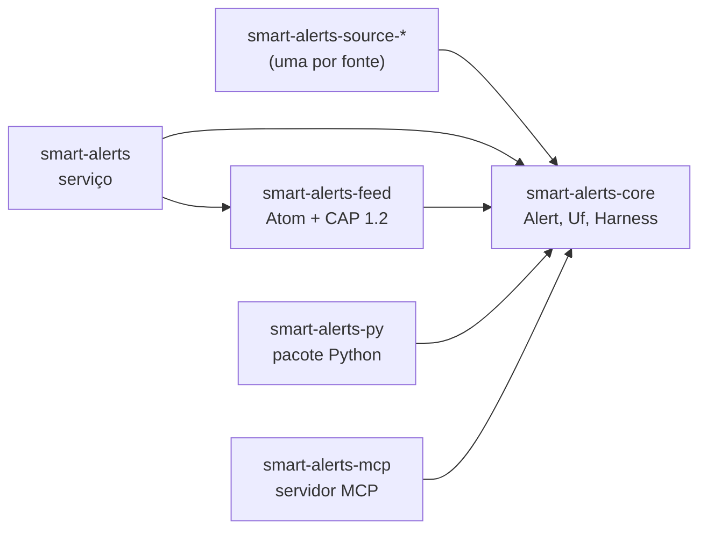

<!-- reading-time: 4 min -->
# Arquitetura

O ialerts é um workspace Cargo em Rust. Cada crate é um diretório em `crates/`.

| Crate | Tipo | Papel |
|---|---|---|
| `smart-alerts-core` | lib | Os tipos do domínio (`Alert`, `Uf`, `Severity`, `Hazard`) e o harness. O núcleo não conhece Discord, Python nem MCP. |
| `smart-alerts` | bin | O serviço: publica no Discord e no feed. |
| `smart-alerts-feed` | lib | O canal Atom com CAP 1.2. |
| `smart-alerts-py` | cdylib | O pacote Python (PyO3 e maturin): `import smart_alerts`. |
| `smart-alerts-mcp` | bin | O servidor MCP (rmcp, stdio). |

Como ler esta figura

**Em uma frase.** Todo crate depende do `smart-alerts-core`. O núcleo não depende de nenhum crate.

**Como ler.** Cada seta vai do crate que usa para o crate usado.

**Fora da figura.** Os crates de fonte ainda não existem.

**Evidência.** O `Cargo.toml` de cada crate em `crates/`.

## O harness funcional

O desenho segue o artigo [Object-Oriented Harness](https://arxiv.org/abs/2610.28380) (arXiv
2610.28380) e traduz o artigo para composição de funções.

- Um estágio (`Stage`) é uma função `Fn(Alert) -> Option<Alert>`. O estágio passa o alerta
  adiante, talvez mudado, ou descarta o alerta.
- O `Harness::then` acrescenta um estágio. O `Harness::run` aplica os estágios em ordem, com um
  `try_fold`.
- O núcleo tem dois estágios: `only_ufs` (mantém os alertas de certos estados) e `min_severity`
  (mantém os alertas a partir de uma severidade).
- Uma especialização compõe um estágio novo. O ialerts não usa hierarquias de traits parecidas com
  herança.

| Harness orientado a objetos | ialerts |
|---|---|
| Uma subclasse sobrescreve um método | Um `Stage` novo envolve o pipeline: `Harness::then` |
| `super()` | Os estágios anteriores na composição |
| Cadeia de herança | Composição de funções (`try_fold` sobre os estágios) |
| Um roteador escolhe uma classe | Uma função pura casa um enum e devolve um `Harness` |
| Volta para o harness base | `Option` ou `Result` volta para o harness base |

## Modelos locais, no futuro

Algumas fontes publicam texto livre (boletins, PDFs). Para essas fontes, o ialerts vai usar modelos
abertos que rodam na máquina local. Cada modelo é um estágio.

| Runtime | Licença | Uso | Estado |
|---|---|---|---|
| [Ollama](https://github.com/ollama/ollama) | MIT | Ler texto livre e extrair campos (local, hora, nível do rio) | planejado |
| [OLLAYA](https://github.com/ollaya-dev/ollaya) | Apache-2.0 | Decidir perguntas tipadas com probabilidade calibrada; não gera texto | em breve |

- Um modelo nunca inventa um alerta. Um estágio de modelo só preenche ou descarta um campo que o
  texto da fonte diz.
- Quando o modelo não tem certeza, o alerta volta para o harness determinístico e fica marcado
  para revisão humana.
